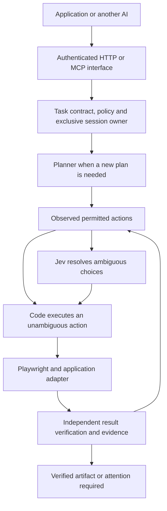

# Shared browser service: handoff for another AI

Prepared 18 September 2026. This is an architecture and implementation brief, not a deployed extension. Local source was inspected; the VPS was not contacted during this handoff. Previously recorded deployment details below must be checked against the running server.

## Objective and recommendation

Let multiple applications use a common browser execution service on the existing Hetzner VPS. Start a separate, bounded experiment for one online video editor. Preserve the frozen payments work and its approval boundary.

Use **Playwright** for browser execution and **MCP** as the standard interface through which another AI can request browser tools. Microsoft's **`@playwright/mcp`** supplies an existing MCP implementation, including accessibility snapshots and coordinate mouse operations. It can accelerate a separate editor prototype. It does not supply our application policies, account ownership, verification or trust layer. Its documentation explicitly says it is not a security boundary. [Official package and documentation](https://github.com/microsoft/playwright-mcp).

Our recommended design is a small authenticated session/job controller, with a Playwright worker and an application adapter. Expose the permitted operations through MCP for AI clients and an HTTP job API for applications. Both interfaces use the same controller and policy checks. A client should not also receive an unrestricted connection around that controller.

Share execution code and infrastructure; give each application/account its own browser state. Playwright contexts separate cookies and storage. For persistent authenticated accounts, retain a dedicated profile with one active owner. Separate worker containers provide resource and filesystem boundaries beyond browser-context separation. [Playwright isolation](https://playwright.dev/docs/browser-contexts).

Stagehand is an optional higher-level alternative if the new application needs natural-language `act`, `observe`, `extract` and agent operations. We have not integrated it or established that it improves our results. Avoid adding a second framework merely to expose the browser. [Stagehand introduction](https://docs.stagehand.dev/v3/first-steps/introduction).

## What exists today

Repository on the user's Mac: `/Users/buena/Code/blockchain-rust-superteam-poland`.
Experiment mirror: `/Users/buena/Documents/ChatGPT/typesafe-ai-experiment/hackathon/jev`.
Paths in this section are relative to the hackathon repository.

| Component | Verified local capability and limitation |
| --- | --- |
| `agent/jev/src/` | Node 22 / Playwright service for configured Glovo basket preparation. One account, bounded queue, job idempotency, cancellation and durable records. This is not a generic browser API. |
| `agent/jev/src/server.mjs` | Minimal unauthenticated `GET /healthz`. Bearer-authenticated `GET /v1/status`, `GET/POST /v1/jobs`, `GET /v1/jobs/:id`, `POST /v1/jobs/:id/cancel`. Job body accepts item queries, quantities and a PLN cap. POST jobs require an `Idempotency-Key`. |
| `agent/jev/src/storage.mjs` | Exclusive persistent-profile lock. Service, onboarding and evaluation tools cannot use that profile concurrently. Interrupted jobs become `needs_attention`; actions are not replayed automatically. |
| `agent/jev/src/desktop.mjs` and `scripts/navigation-desktop.mjs` | Manual login/setup or supervised navigation desktop. This is not a protocol for transferring live control between agents. |
| `agent/jev/experimental/browser-runtime-v4/` | Frozen read-only prototype: bounded `search_and_open` and `open_link` workflows, fresh element references and postconditions. Not general forms, canvas editing, file operations or payments. |
| `agent/jev/Dockerfile` | Copies `src`, `scripts` and `cases`; excludes `experimental/`. The normal service image therefore does not expose v4. |
| `agent/trust/` | Local approval/evidence prototype; freeze manifest in `browser-adapter-freeze.json`. Mandatory screenshot/observation coverage at reached quote, approval and confirmation boundaries. Not connected to a live payment flow. |

Current shopping jobs reopen the persistent profile and close Chromium after the job. Saved cookies are not a continuously running page. `/v1/status` reports saved onboarding state, not proof that the current login is still valid. There is no general session lease, authenticated artifact API or browser-control handoff API yet.

Reuse the queue, ownership, cancellation, journaling and verification patterns. Do not simply expand the Glovo action allowlist into an unrestricted browser. Its merchant-specific request guard is not a universal policy engine.

## Existing server context

The following comes from saved `agent/jev/DEPLOYMENT.md`, not a fresh server inspection:

- Host: `buena-prod-01`, Tailscale `100.121.5.10`; SSH `root@100.121.5.10` through the user's 1Password SSH agent.
- Existing directory `/opt/jev-hackathon`; Compose project `jev-hackathon`; volume `jev-hackathon_jev-data`.
- This was a standalone Compose stack alongside other Coolify projects, not a resource registered in the Coolify dashboard.
- API uses port `8787`; private manual desktop uses `6088`; setup/navigation controller uses `6089`. These are existing allocations, not suggested ports for the new service.
- Browser desktop, when running: `http://100.121.5.10:6088/vnc.html?autoconnect=1`. Controller, when running: `http://100.121.5.10:6089/`.
- The last saved operational notes say browser containers and API were stopped. Do not assume these links currently work or restart a stack without checking its owner and current job.
- Current pilot limits are 2 CPUs, 2 GB RAM and 1 GB shared memory. Video-editor compatibility, rendering performance and available server capacity have not been measured.

First inspect the actual Compose services, image versions, mounts, listeners and available resources. Use a separate application/service, volume and available port for the editor. Preserve Chromium sandboxing and the non-root worker. Keep administrative browser access private to Tailscale/loopback; the existing noVNC desktop has no separate password. Do not expose raw browser debugging ports.

Authentication secrets stay with the service. No API keys, cookies, browser-profile contents or home-address details are included in this handoff. New deployments should use protected secrets managed for that application; do not assume evaluation credentials were persisted on the VPS.

## Division of responsibility

**Code** owns permissions, action arguments, timing, session ownership, deterministic checks and verification. A known valid action needs no model call.

**Jev** chooses between currently observed, permitted options. Send concise text with task context, fresh references, element identity, location and supported operations; include a `none` choice. Prefer valid target/action pairs to independently chosen targets and commands that may not be compatible. Jev confidence is neither authorization nor proof that an action succeeded.

**A general model** compiles unfamiliar requests into bounded steps and produces new text when required. **A vision-capable model** can interpret a screenshot when the DOM does not describe a timeline or canvas. Jev currently accepts text/JSON, not images, audio or video. Visual interpretation must therefore become structured textual candidates before Jev can evaluate them. [TypeSafe state documentation](https://docs.typesafe.ai/concepts/state).

Keep screenshots optional for ordinary decisions and mandatory at relevant audit boundaries. Payment quote/approval/confirmation evidence remains required even if the selector used only text. A video workflow should capture source/project state, edit verification and export completion, plus a hash of the exported file. Hashes establish integrity against a trusted record, not the truth of an unverified model claim.

## Proposed interface, not existing endpoints

Implement one controller with tenant/application-scoped credentials. A caller's identity determines which profiles, files and operations it can use; callers cannot select another account merely by guessing an ID.

| Proposed operation | Contract |
| --- | --- |
| `session.acquire` / `session.release` | Lease one approved account/profile to one owner; return session ID and ownership version. Revoke stale owners before handing control to another agent. |
| `browser.observe` | Return URL, page/frame identity, observation version, accessible controls and supported actions; optional screenshot artifact ID. |
| `browser.act` | Accept a bounded typed operation against that observation. Revalidate the target and allowed effect before dispatch. Never execute an old coordinate after navigation or viewport changes. |
| `job.submit` / `job.status` / `job.cancel` | Accept a validated application task, idempotency key and action/time/cost budgets. Record progress and uncertain effects durably. |
| `artifact.read` | Return only artifacts belonging to that caller/job; do not accept arbitrary filesystem paths. |

Start with navigate, click, fill, select, key presses, scroll and observation. Playwright supports these input primitives, file selection and dragging; an application adapter must still establish what the action means and verify its effect. [Playwright actions](https://playwright.dev/docs/input).

Add iframe targeting and coordinate dragging only for the chosen editor's actual controls. Coordinate tools require a fresh viewport, target bounds and an outcome check; they are not general visual understanding. Keep raw JavaScript evaluation, arbitrary URL/file access and unrestricted CDP out of the application tool contract. Pin reviewed dependencies and image versions before reproducing measurements.

Policy is per application: shopping preparation, video editing and publishing have different allowed effects. A video session must not inherit Glovo cookies, payment permissions or its volume. Existing uploads remain blocked in the current evaluation; the new workflow needs a specifically authorized source asset and editor destination before implementing an upload step.

For handoff between AIs, checkpoint the task, allowed capabilities, policy/runtime versions, job/session ID, owner version, budgets, latest verified outcome, pending/uncertain action and private evidence IDs. Pause the old controller, transfer ownership and observe again. Never resume by replaying stale element references or an action whose effect is unknown. Idempotency in our queue does not guarantee exactly-once effects on another website.

## First video-editor implementation slice

Do not promise every online editor. Pick one editor and an existing test project/clip owned by the user. Where the editor provides a supported API for the requested operation, use that API through the same task contract and verifier; use the browser for required UI steps.

1. Confirm the selected editor opens, signs in, previews and exports manually in a separate server browser. Check WebGL/codecs and memory/CPU use on that actual image. Some editors render remotely; others depend heavily on the browser. This remains unknown until an editor is chosen.
2. Define a single task: open the test project, retain seconds 2–8 of a known clip, add a supplied caption, save a copy, export a specified format and download it. Use an asset already in the editor first. If upload is necessary, scope access to one approved asset and destination.
3. Prefer accessible controls and numeric timecode fields; use keyboard shortcuts where their effect is known. Implement adapter operations such as `trim_range`, `set_caption`, `save_copy` and `export_video` with postconditions. Use visual dragging only where the editor requires it.
4. Verify the saved project and actual downloaded file. Check duration with a declared frame tolerance, dimensions, expected audio, and sample frames showing the requested trim and caption. Record file size and SHA-256. A toast saying “exported” is insufficient.
5. Stop at the verified local export. Publishing, sharing, deleting originals, subscription upgrades and purchases are outside this first task.
6. Run three bounded attempts from equivalent starting copies, saving failures and interventions. Report verified success first, full wall time second, total attributable cost per success third. Break out browser startup, model calls, upload/render/download and retries. Label missing infrastructure/provider charges as unknown; zero successes means no finite cost-per-success result.

This proves one useful workflow. It does not establish broad editor compatibility or a fastest-agent claim. The earlier sub-second results came from controlled local browsing fixtures, not video editing. The bounded Amazon report likewise established no comparative winner.

## Brief to give the implementing AI

> Read this handoff and the local service files before changing anything. Build a separate browser application for one chosen online editor on the existing VPS, using Playwright and a narrow authenticated MCP/HTTP interface. First inspect server state and establish a dedicated profile, ownership and resource allocation. Preserve frozen browser-runtime-v4 and the payment mandate/evidence boundary. Reuse our journaling, bounded execution and independent verification patterns. Use Jev for textual choices, a planner for unfamiliar tasks and a vision model only for controls the DOM cannot describe. Prove one trim/caption/save-copy/export workflow on an approved test asset, retain evidence and report cost per verified success including retries. Mark new capabilities and remaining limitations explicitly. Do not claim an endpoint exists until it is implemented and tested.

Before executing that slice, resolve the editor URL/account, test project or asset, desired output settings and any upload authorization. These details are not yet specified; preparing the reusable service design does not authorize arbitrary media uploads or publication.
